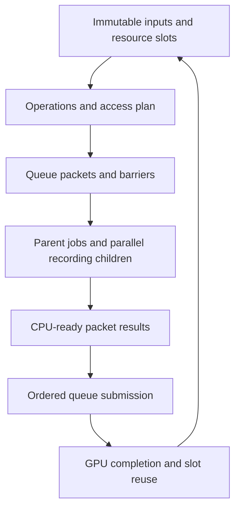
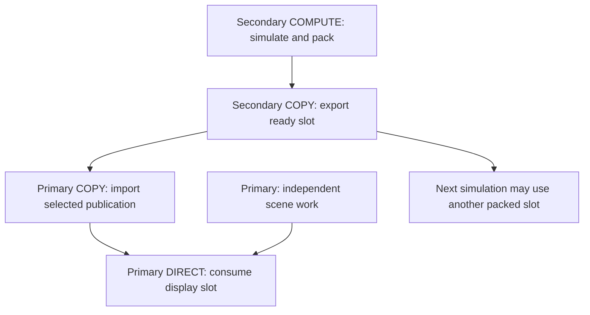
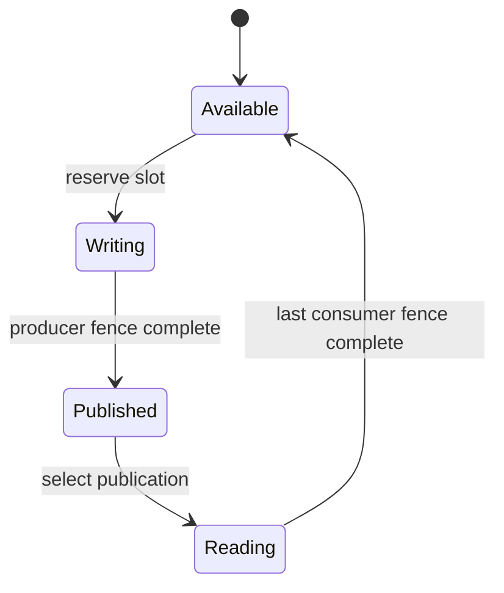

# MetaRenderGraph: iterative implementation - Plan

## Goal Capsule

Создать дополнительное приложение, в котором подготовка GPU-команд выполняется параллельными и вложенными группами jobs, а очереди исполняют пакеты по явным зависимостям. Получить рабочую сцену с существующими техниками сначала на одной DIRECT-очереди, затем на DIRECT/COMPUTE/COPY одной карты, затем на двух картах с независимым продвижением симуляций и рендера.

Это мета-задание для последовательного выполнения связанных заданий U1–U12. При подготовке этого пакета реализация не выполняется. Передача отдельного задания исполнителю разрешает выполнить только этот этап и исправить необходимые дефекты его предпосылок, но не начинать следующие этапы автоматически.

Текущий App и его граф остаются рабочими. Итог мета-задания — отдельный проверенный путь и доказательства его работы; переключение основного App и удаление старого графа сюда не входят. После каждого этапа — локальный коммит своих изменений, отчёт о проверках и передача следующему исполнителю; push только по отдельному запросу пользователя.

---

## Product Contract

### Summary

Добавить проект `Apps/App.MetaRenderGraph/App.MetaRenderGraph.vcxproj`. В нём поэтапно подключить существующие техники к новому плану исполнения. Переиспользовать алгоритмы, шейдеры, сцену и ресурсы движка; разделить подготовку входов, планирование зависимостей, запись command lists, отправку и освобождение используемых слотов.

### Problem Frame

Текущий `GDX12RenderGraph::Execute` совмещает последовательную запись и отправку команд. Состояния ресурсов меняются во время записи через общий `GDX12Resource::_currentState`. Перенос воды имеет собственный цикл и submissions. Такая организация затрудняет независимую параллельную запись, объединение передач и перекрытие вычислений с копированием. Полная одномоментная замена затруднила бы проверку причин регрессий.

### Requirements

**Изоляция и порядок развития**

- R1. Новый исполняемый проект сосуществует с текущим App; выбор нового исполнителя явный и действует только для экспериментального приложения.
- R2. Этапы идут в порядке: одна карта/DIRECT → параллельная CPU-запись и подключение техник → async одной карты → межкарточное исполнение. CPU-parallel recording не считается GPU async.
- R3. Каждая подключённая техника исполняется новым планом, а не скрытым вызовом всего старого графа. Численные модели и визуальные алгоритмы сохраняются.

**Jobs и пакеты**

- R4. Верхнеуровневая операция может создавать N дочерних jobs записи и продолжение после их завершения. Сборка результата не зависит от порядка завершения workers и не блокирует весь worker pool ожиданием детей.
- R5. Результат операции содержит пакеты: очередь/устройство, набор зависимостей, упорядоченные command lists и публикуемую точку завершения. CPU-ready и GPU-complete — разные события.
- R6. Исполнитель отправляет готовую работу с требуемыми Wait/Execute/Signal, располагая ожидания перед первым зависимым пакетом. Глобальное ожидание записи всего кадра не является обязательным свойством API.

**Ресурсы и поведение**

- R7. Структура сцены и ёмкости могут быть фиксированными; слоты, диапазоны, состояния и зависимости планируются до записи. Существование ресурса не разрешает перезаписывать данные, которые GPU ещё использует.
- R8. Сохраняются RAW/WAR/WAW-зависимости, UAV ordering, допустимые переходы состояний и завершение всех читателей перед записью. Jobs не изменяют общий state tracker по порядку своего фактического завершения.
- R9. Декомпозиция исполнения сохраняет результат техники: общая сортировка SortedAlpha, WBOIT resolve, история motion vectors, pause/reset и входы симуляции не зависят от размещения работы.

**Async и MGPU**

- R10. На одной карте поддерживаются явные DIRECT/COMPUTE/COPY-пакеты и смешанное размещение допустимых групп работы. Сериализованный режим остаётся диагностическим эталоном.
- R11. На двух картах фоновые симуляции и основной рендер продвигаются независимо от Present друг друга. Потребитель может требовать определённую публикацию либо брать готовую; оба варианта сохраняют синхронизацию доступа.
- R12. На вторую карту сначала переносится существующая вода, затем все явно отмеченные допустимые эмиттеры частиц. DepthCollision=true запрещает перенос эмиттера; глубина сцены между картами в этом пакете не передаётся.
- R13. Все перенесённые эмиттеры частиц публикуют общий буфер данных для рендера с согласованными метаданными; число transport copies не растёт с числом эмиттеров. Вода и частицы не обязаны ждать друг друга ради общей публикации.
- R14. Цель — полезное перекрытие вычислений, копирования и рисования. Лимиты кадра, freshness/debt, автоподбор частот/качества и обещание 100% загрузки или гарантированного прироста FPS не входят в механизм.

### Scope Boundaries

Базовый набор техник — текущие Default/Bistro pipelines: object upload/culling, depth/GBuffer, тени, IBL/cloud source, reflection probes, AO/SSR, трава и interaction field, вода, частицы, прозрачность, postprocessing/reconstruction/output, world/offscreen UI и posters. U1 фиксирует точный перечень действующих вариантов и относит каждый к этапу; новая функциональность техник не добавляется.

До U8 все GPU-команды нового пути идут на одной DIRECT-очереди, даже если внутри есть compute dispatch. До U9 не открывается второе устройство. До U10 существующий water offload не включается в эксперименте; до U11 не включается существующий particle offload. Текущий App этими ограничениями не затрагивается.

Не входят: удаление старого графа, автоматический перенос всех техник, третья карта, удалённый рендер, новый редактор графа, автоматическая балансировка, новые физические модели, универсальный allocator с aliasing и горячее удаление/стриминг произвольных объектов. Resize/reset и завершение незаконченной GPU-работы входят, поскольку нужны обычному запуску приложения. Временно увеличенная память эксперимента учитывается в отчёте, не маскируется.

---

## Planning Contract

### Key Technical Decisions

- KTD1. Отдельный App.MetaRenderGraph и минимальный opt-in seam исполнения в App.Base сохраняют текущий App. `IRenderPipeline::BuildGraph` сейчас привязан к старому графу; одной новой реализации IRenderPipeline недостаточно. U1 находит точную границу, U2 реализует её. (session-settled: user-directed — chosen over immediate replacement: пользователь требует итеративную разработку рядом с рабочим путём.) Governs R1–R3.
- KTD2. План состоит из операций и зависимостей, затем компилируется в пакеты очередей. Группа техники не превращается в обязательный барьер для всех её дочерних пакетов; независимые результаты доступны отдельно. Governs R4–R6.
- KTD3. Снимок входов, ресурсы и назначения диапазонов фиксируются до jobs записи. Пролог/эпилог группы владеют общими переходами; дочерние списки не переключают один destination buffer независимо друг от друга. Контекст состояний локален списку и согласуется с планом. Governs R7–R8.
- KTD4. Сначала явные постоянные ресурсы и заранее выделенные слоты без нового aliasing. Декларации доступа могут быть на весь ресурс; более точные диапазоны нужны там, где используются непересекающиеся бакеты одного буфера. Разные диапазоны не разрешают разные состояния одного buffer subresource. Governs R7–R8.
- KTD5. Алгоритм техники переиспользуется через явно отделённую запись команд. Он не отправляет очереди и не ждёт GPU из worker job. Неперенесённая внутренняя мутация может временно сделать конкретную технику последовательной на CPU, но не весь граф; это отражается в отчёте U12 и не считается выполнением R4 для этой техники.
- KTD6. CPU continuation после дочерних jobs является продолжением зависимости, а не блокирующим Complete внутри worker. Изменения JobSystem сохраняют текущие пользовательские контракты. Сборка массива идёт по назначенным индексам, а не порядку завершения. Governs R4.
- KTD7. GPU tokens разрешаются в значения fences владельцем очереди. Одно место отвечает за порядок Wait/Execute/Signal и счётчик каждой очереди; независимые writers не перемешивают submission-транзакции. Ошибка записи не публикует ложное завершение. Governs R5–R6.
- KTD8. Для COPY↔DIRECT/COMPUTE план учитывает допустимые состояния, COMMON-передачи и promotion/decay согласно D3D12. Переход состояния не заменяет межочередный fence. Пакет не обрывается посреди неподдерживаемого queue transition. Governs R8, R10.
- KTD9. На MGPU симуляционный цикл имеет собственные слоты команд/входов. Основной цикл имеет свои слоты display/import. Общие publication slots защищены ready/consumed fences; завершение копирования освобождает транспортный слот, завершение рисования — display slot. Governs R11.
- KTD10. Strict dependency и LatestCompleted выбирают версию данных; они не выключают защиту памяти. LatestCompleted сохраняет последний готовый display, если новый импорт ещё не завершён. Перед возвратом к записи ждут все читатели именно выбранного слота. Governs R8, R11.
- KTD11. Существующие новые water/particle offload implementations служат эталонами модели и транспорта. В эксперименте их собственные workers/submissions заменяются пакетами нового исполнителя, а не запускаются рядом вторым скрытым runtime. Governs R3, R12–R13.

### Architecture



Направляющая форма пакета: `QueueKey + WaitTokens[] + CommandLists[] + CompletionToken`; это описание контракта, не фиксированная C++-сигнатура. До U8 QueueKey имеет единственный исполняемый вариант, до U9 — одно устройство. План заранее определяет входные/выходные состояния; значения GPU fences связываются при submission, а не при случайном завершении recording jobs.



Для каждого переиспользуемого packed/shared/display slot существует обратная зависимость на завершение последнего читателя. Граф проверяет циклы для конкретных экземпляров пакетов, включая межитерационные зависимости; допустимое кольцо слотов разворачивается в ациклическую последовательность работ.



### Evidence and Integration Points

Проверено при подготовке на HEAD `f8218028`, ветка `codex/bistro-rendering`; particle-offload чат в это время меняет общие файлы и индекс. У будущего исполнителя актуальные исходники и результаты предшествующих этапов имеют приоритет над этим снимком.

- `Apps/App.Base/src/RenderModule.cpp`: OnRender/RebuildRenderGraph владеют старым executor и его созданием; требуется opt-in seam, не подмена глобального поведения.
- `Apps/App.Base/Include/App.Base/Rendering/IRenderPipeline.h`, `CommonRenderPasses.h`: lifecycle, графовые связи и reusable техники.
- `Engine/Engine.RendererDX12/src/GDX12RenderGraph.cpp`: Compile, lifetime pooling, Execute и существующие DIRECT/COMPUTE joins.
- `Engine/Engine.RendererDX12/src/GDX12Resource.cpp`: GetTransitionBarrier изменяет общий state во время записи; это несовместимо с произвольной параллельной записью без адаптации.
- `Engine/Engine.RendererDX12/src/GDX12CommandQueue.cpp`, `GDX12CommandList.cpp`: ownership command lists, fence issuance, allocator retirement; проверить актуальные изменения particle-offload перед расширением.
- `Engine/Engine.Core/Include/Engine.Core/Jobs/JobSystem.h`, `Engine/Engine.Core/src/Jobs/JobSystem.cpp`: Schedule/Complete owner-thread-only; QueueTask — нижняя интеграция enkiTS. Не считать вложенные worker Schedule уже реализованными.
- `Apps/App.Benchmark/App.Benchmark.vcxproj`, `GlobalSettings.props`, `MSBuild/Props/`: проект и выходные каталоги. `Apps/App/WaterOffloadBistroTests.vcxproj` показывает повторное использование App sources с другим entry point; для долгоживущего проекта избегать неявного наследования чужого exe entry/config.
- `Apps/App/src/Rendering/BistroRenderPipeline.*`, `Apps/App.Base/src/Rendering/CommonRenderPasses.cpp`: перечень техник и порядок их композиции.
- `docs/adr/0003-indirect-rendering-parallel-object-preparation.md`: сохранить GPU-driven ExecuteIndirect; CPU-buckets не означают замену indirect на тысячи draw calls.
- `docs/reports/2026-11-12-water-only-mgpu.md`, `docs/plans/2026-11-13-particle-simulation-mgpu.md`: текущие модели/ограничения. Старые MGPU ADR-0011/0012/0013 отменены и не являются требованиями этой реализации.

D3D12 contracts: [command lists and allocators](https://learn.microsoft.com/en-us/windows/win32/direct3d12/recording-command-lists-and-bundles), [ExecuteCommandLists batching](https://learn.microsoft.com/en-us/windows/win32/api/d3d12/nf-d3d12-id3d12commandqueue-executecommandlists), [resource barriers](https://learn.microsoft.com/en-us/windows/win32/direct3d12/using-resource-barriers-to-synchronize-resource-states-in-direct3d-12), [multi-engine synchronization](https://learn.microsoft.com/en-us/windows/win32/direct3d12/user-mode-heap-synchronization), [shared heaps](https://learn.microsoft.com/en-us/windows/win32/direct3d12/shared-heaps).

### Output Structure

Новые имена — предлагаемые пути, не утверждение об уже существующем коде. U1 фиксирует реальные пути в отчёте; следующие этапы используют их вместо создания дублей.

```text
Apps/App.MetaRenderGraph/
    App.MetaRenderGraph.vcxproj
    src/App.cpp
    src/MetaRenderPipeline.*
    src/Graph/                 # plan, compiler, recorder, submitter, completion
    src/Techniques/            # adapters to existing techniques
    tests/                    # CPU planner and GPU integration fixtures
    Configs/                  # isolated startup settings
docs/reports/meta-render-graph/
    01-project.md ... 12-acceptance.md
    technique-inventory.md
```

Не создавать заранее пустые классы для всех будущих функций. Экспериментальные файлы принадлежат новому проекту; в shared Engine/App.Base выносится только реально используемый seam или повторно используемая часть техники.

---

## Implementation Units

Последовательность намеренно линейная: это очередь заданий для отдельных чатов, а не разрешение параллельно менять одни и те же shared interfaces. Внутри этапа возможны независимые подзадачи. Каждый linked task содержит Files, Approach, Smoke-check и выходной контракт; они являются частью мета-задания.

| Unit | Задание | Зависит от | Проверяемый результат |
|---|---|---|---|
| U1 | [01-project](01-project.md) | — | Дополнительный executable, изоляция, baseline и инвентарь |
| U2 | [02-direct-plan](02-direct-plan.md) | U1 | Новый план и executor на одной DIRECT, реальные buffer fixtures |
| U3 | [03-recording-jobs](03-recording-jobs.md) | U2 | Вложенные группы и параллельная запись без shared-state гонок |
| U4 | [04-geometry-shadows](04-geometry-shadows.md) | U3 | Upload/culling/depth/GBuffer/тени/трава |
| U5 | [05-lighting-reflections](05-lighting-reflections.md) | U4 | IBL/clouds/probes/AO/lighting/SSR |
| U6 | [06-water-particles](06-water-particles.md) | U5 | Текущие вода/частицы/прозрачность на одной DIRECT |
| U7 | [07-post-ui](07-post-ui.md) | U6 | Post/UI/reconstruction/present; однокарточная приёмка |
| U8 | [08-async-single-gpu](08-async-single-gpu.md) | U7 | DIRECT/COMPUTE/COPY, смешанные группы и поздние waits |
| U9 | [09-cross-adapter-transport](09-cross-adapter-transport.md) | U8 | Двухкарточные tokens, slots, общий транспорт и независимые циклы на fixture |
| U10 | [10-mgpu-water](10-mgpu-water.md) | U9 | Вода целиком через новый executor на двух картах |
| U11 | [11-mgpu-particles](11-mgpu-particles.md) | U10 | Отмеченные depth-independent эмиттеры и общая передача |
| U12 | [12-acceptance](12-acceptance.md) | U11 | Совместная приёмка, доказательства и воспроизводимая передача |

Не пропускать U7 ради раннего MGPU. В U4–U7 подключать по одной подгруппе техники и обновлять инвентарь; файлы заданий перечисляют эти внутренние границы. При нехватке контекста передавать фактически завершённую подгруппу, не объявлять весь этап готовым.

---

## Verification Contract

По решению пользователя от 2026-11-14 приёмка U1–U12 ограничена принципом «работает / не работает». Правило применяется и к старым отчётам: их расширенные проверки остаются историей, а прежние требования новых прогонов больше не являются условиями приёмки.

- Достаточен один обычный короткий smoke нужной функции: приложение запускается, GPU выполняет работу, результат есть, явных ошибок или падения нет. Уже полученное свидетельство работы засчитывается без повторного запуска.
- При переносе уже работающего вычисления с DIRECT на COMPUTE повторная проверка математики не требуется. Для очередей/межкарточного пути достаточно увидеть выполнение и поступление результата потребителю.
- Численная точность, tolerances, побитовое/пиксельное равенство, parity с эталоном, пограничные и искусственные ошибочные сценарии, матрицы режимов, lifecycle/stress-серии, повторные A/B-прогоны, профилирование и performance captures не входят в приёмку. Они выполняются только по отдельному явному запросу пользователя.
- Новые test targets и расширение fixtures ради покрытия не требуются. Существующий запуск приложения или fixture достаточен. При режиме «только реализация» либо запрете тестов/сборок разрешена только проверка кода; smoke не запускается.
- Краткий отчёт: commit, выбранный режим/адаптеры, итог «работает / не работает / не запускалось» и конкретная проблема, если есть. Отсутствие оборудования указывается как причина отсутствия запуска, без выдуманных результатов.
- Эта граница проверок не отменяет реализацию ресурсных зависимостей, fences, lifetime и обработки ошибок. Найденный явный дефект исправляется без расширения объёма проверок.

---

## Definition of Done

1. U1–U12 имеют проверяемые результаты и отдельные отчёты; все обязательные техники из инвентаря подключены или отсутствуют в актуальном baseline с указанной причиной.
2. Новый executable действительно использует новый план, параллельную запись и единый механизм submissions; старый GDX12RenderGraph::Execute и внутренние offload-workers не исполняют эксперимент за его спиной.
3. Работают single-DIRECT, same-GPU async и двухкарточная вода+частицы. Перенос частиц соблюдает DepthCollision и общее копирование.
4. Обычный запуск подтверждает выполнение GPU-работы и наличие результата без явных ошибок; применён только Verification Contract выше.
5. Default path текущего App не переключён и старый граф не удалён; обязательной повторной сборки или регрессионной серии для приёмки нет.

### Assumptions and Deferred Details

План предполагает тот же checkout, ресурсы Bistro и доступ к уже используемым библиотекам. Точный способ sharing App sources и opt-in execution seam выбирается в U1–U2 по актуальному коду; существование этих seams не предполагается. Число slots, размеры buckets и границы объединения packets выбираются по существующим ресурсным контрактам.

Текущий объём U7 — Native и FSR. FG и остальные провайдеры отложены по указанию пользователя; существующие hooks сохраняются, проверки этих вариантов не требуются. Массовая runtime-миграция объектов и автоматическая замена production App требуют отдельного задания.

---

## Handoff Contract

Для запуска конкретного этапа достаточно следующего запроса, подставив путь к его файлу:

```text
Реализуй только этап из docs/plans/2026-11-13-meta-render-graph/01-project.md.
Сначала прочитай 00-meta-plan.md в той же папке и отчёты обязательных предыдущих этапов.
Проверь актуальный код и предпосылки. Сохрани посторонние staged/unstaged изменения.
Выполни этап в разрешённом пользователем режиме и соблюдай Verification Contract: только короткий smoke, если запуски разрешены. Подготовь краткий отчёт и локальный коммит. Следующий этап не начинай.
```

Нельзя считать переданный meta-plan разрешением автоматически запустить все этапы, когда пользователь запросил один. Несколько чатов не должны одновременно владеть изменениями одного shared runtime. Пакет не отменяет текущую работу отдельного чата над production particle offload.
