# Текущий граф рендера приложения

Исторический срез ниже относится к 2026-11-02. Размещение проходов на нескольких GPU, Direct/Compute/Copy и актуальные переключатели описаны в [руководстве MGPU](multi-gpu.md).

Срез исходного кода рабочего дерева на 2026-11-02 после интеграции runtime SR/FG. Это восстановленная по коду схема, не GPU capture: наличие прохода в списке не означает, что каждый его внутренний dispatch выполняется каждый кадр.

Порядок задаётся вручную в `RenderModule::ConfigureRenderPipeline`, а ресурсы связываются через `SetInputs`. Автоматического планировщика render graph здесь нет. Источники: [регистрация, связи и исполнение](../../Apps/App.Base/src/RenderModule.cpp).

## Порядок проходов

Сплошные стрелки показывают порядок исполнения, а не передачу одного color buffer. AO выполняется ровно в одной из двух отмеченных позиций.

```mermaid
flowchart TD
    Prep["Подготовка: skinning, grass, reflection scene"] --> Clear
    subgraph Geometry["Геометрия и освещение"]
        Clear["0 · Clear window depth"] --> Env["1 · Environment IBL / atmosphere LUTs"]
        Env --> Cull["2 · GPU culling"]
        Cull --> Depth["3 · Reverse-Z depth prepass"]
        Depth --> Early["AO при ExecutionPoint=0; иначе пропуск"]
        Early --> CSM["4 · Cascaded shadows"]
        CSM --> Local["5 · Local shadows"]
        Local --> Probes["6 · Reflection probes"]
        Probes --> GB["7 · Opaque/masked G-buffer"]
        GB --> Late["8 · AO при ExecutionPoint=1 — default; иначе пропуск"]
        Late --> Lit["9 · Clustered deferred lighting → linear HDR"]
        Lit --> SSR["10 · SSSR + denoiser + specular resolve"]
    end
    subgraph Transparency["Вода, прозрачность и частицы"]
        Fluid["11 · Fluid simulation + surface depth/motion"] --> Behind["12 · WBOIT behind water"]
        Behind --> BC["13 · Behind HDR composition + sky/aerial perspective"]
        BC --> Water["14 · Fluid HDR resolve"]
        Water --> Front["15 · WBOIT in front of water"]
        Front --> Particles["16 · Particle simulation/cull/sort + accumulation"]
        Particles --> FC["17 · Front HDR composition + particle composite"]
    end
    SSR --> Fluid
    subgraph Post["Постобработка и вывод"]
        DOF["18 · FidelityFX DoF"] --> MB["19 · Feature-aware motion blur"]
        MB --> SR["20 · Native / XeSS / FSR / DLSS / NIS → linear HDR"]
        SR --> Output["21 · Reinhard + sRGB → RGBA8 UNORM"]
        Output --> Prepare["FG inputs / preparation; Off — пропуск"]
        Prepare --> Submit["Submit command list"]
        Submit --> FG["FG dispatch + pacing через proxy Present: Off / AMD / NVIDIA / Intel"]
        FG --> Present["SDR presentation"]
    end
    FC --> DOF
```

Нумерация — индексы текущего списка из 22 passes. FG интегрирован в lifecycle/presentation отдельно от этого списка. При раннем AO код вызывает AO сразу после depth prepass и пропускает его обычную позицию: [OnRender](../../Apps/App.Base/src/RenderModule.cpp).

## Зависимости ресурсов

| Производитель | Ресурсы | Потребители |
| --- | --- | --- |
| G-buffer | Albedo/metallic, motion, reverse-Z depth, world normal/roughness, F0/baked, emissive | AO, deferred, SSSR, fluid surface, прозрачность |
| Depth prepass | Общий opaque depth; normals в раннем режиме AO | G-buffer с Equal/no depth writes, AO |
| Environment | Diffuse irradiance, GGX radiance, DFG, source cubemap | Deferred, probes, SSSR, transparency, water |
| CSM / local shadows | Атласы теней | Deferred, transparency; local shadows также probe capture |
| Reflection probes | Опубликованные поколения probe radiance/metadata через shared resources | Deferred/specular resolve и отражения прозрачности |
| Deferred → SSSR | Linear HDR и раздельные данные specular fallback | Behind composition; SSSR заменяет specular, не складывает его повторно |
| Fluid surface | Ближайшие water/opaque depth и motion | WBOIT partition, DoF, motion blur, SR/FG |
| Behind WBOIT | Weighted accumulation + revealage | Behind composition поверх SSSR HDR |
| Fluid resolve | HDR воды поверх behind composition | Front composition |
| Front WBOIT + particles | Front accumulation/revealage; particle composite | Front composition |
| Front composition → DoF | Linear HDR, combined depth | DoF → motion blur |
| Motion blur | Linear HDR + feature-aware unjittered NDC motion | SR/FG; depth приходит из fluid surface |
| SR | Linear RGBA16F в разрешении окна; native возвращает исходный full-resolution цвет | Собственный финальный output pass |
| Output pass | Reinhard + sRGB в RGBA8 | FG presentation / Swapchain Present |
| FG | SDR backbuffer, combined depth, feature motion и camera/frame constants | Один промежуточный кадр (2x), если доступен; Off сохраняет обычный Present |

Точные соединения: [SetInputs](../../Apps/App.Base/src/RenderModule.cpp). Контракт XeSS: [HDR/depth/motion](../../Engine/Engine.RendererDX12/Include/Engine.RendererDX12/RenderPasses/GDX12XeSSUpscalePass.h).

## Условные пути

- AO: `Render.AO.ExecutionPoint=0` — после prepass, `1` — после G-buffer перед lighting; default `1`.
- Environment, shadows и probes используют собственные условия обновления/кеши. Grass и skinned meshes встроены в соответствующие геометрические проходы.
- При отсутствии активной воды fluid surface возвращает opaque depth/motion. Поэтому downstream-потребители используют combined links, даже когда они фактически указывают на opaque buffers: [fluid pass](../../Engine/Engine.RendererDX12/src/GDX12FluidPass.cpp#L422).
- SSSR/DoF/motion blur имеют neutral/copy paths при отключении. Front composition может отдавать входной HDR без дополнительной композиции.
- Particles пишут в front accumulation; дополнительная композиция вызывается из front composition. Это не отдельный fullscreen pass после апскейлера.
- Все зарегистрированные passes относятся к primary GPU. Secondary GPU отключён буквальным `if (false)`. Streamline инициализируется до создания устройства; недоступность диагностируется с fallback.
- `GDX12ReconstructionPass` сохраняет стабильный output link при переключении native/XeSS/FSR/DLSS/NIS. Изменения применяются до camera jobs с GPU wait, обновлением render grids/jitter и сбросом истории.
- FG выбирается независимо от SR и проверяется по реальным возможностям SDK/адаптера. AMD/XeFG используют native объекты внутри и Streamline presentation hook снаружи. NVIDIA FG требует Reflex/PCL; Intel — XeLL.
- Смена FG/restart пересоздаёт presentation с ожиданием GPU и SDK presents. Pause/minimize/resize останавливают FG. UI pass отсутствует.

## Почему HDR упоминается рядом с XeSS

Здесь HDR — диапазон **внутреннего scene-linear цвета**. Он сохраняется через композицию, DoF, motion blur и SR. Это позволяет выполнить собственное преобразование для экрана один раз в конце, независимо от выбранного SDK.

Апскейлеры не выполняют наш tone mapping. После SR отдельный [ToneMap.hlsl](../../Engine/Engine.RendererDX12/Shaders/ToneMap.hlsl) вызывает собственный [ToneMapToSRGB](../../Engine/Engine.RendererDX12/Shaders/PBRMath.hlsli): `max(x,0)/(1+max(x,0))`, затем sRGB encoding. Это существующий Reinhard.

Мониторный HDR исключён по указанию пользователя: [BuildBackBuffer](../../Apps/App.Base/src/RenderModule.cpp) создаёт `R8G8B8A8_UNORM`, Reinhard/sRGB сохранён. Внутренние float HDR targets — часть освещения и постобработки, а не включённый HDR-режим монитора.

Существующие обзорные документы местами отражают более раннюю цепочку без fluid/front-particles. Эта схема основана на текущих регистрациях и links, а не на тех сокращённых описаниях.

## Уточнения после обсуждения

Цепочка: `scene-linear HDR → SR → Reinhard/sRGB → FG presentation → Present`. FG не является ещё одним HDR-проходом перед тонмаппингом: [NVIDIA](https://github.com/NVIDIA-RTX/Streamline/blob/v2.14.16/docs/ProgrammingGuideDLSS_G.md) требует для HUD-less тот же color space и postprocessing, включая tonemapping, что у backbuffer; [Intel](https://github.com/intel/xess/blob/v3.0.2/doc/xess_fg_developer_guide_english.md) также требует уже полностью обработанный display-color.

Без компонентов skinning/grass/воды соответствующие точки входа всё равно вызываются и проверяют сцену/состояние, но тяжёлая GPU-работа отсутствует. Skinning не dispatch-ит пустой список; grass не создаёт pipelines до появления draw items и выходит до генерации при нулевой ёмкости; fluid surface при отсутствии simulation/render work возвращается с opaque depth/motion links, а fluid resolve сразу возвращает исходный background. Если компоненты были и затем удалены, остаётся работа по безопасному освобождению ранее созданных ресурсов.
