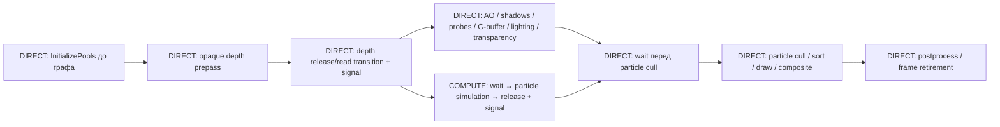

# Async Compute: сначала частицы

Дата плана: 2026-11-04. Статус на 2026-11-05: particle-only async и совместное чтение opaque depth реализованы; режим остаётся default-off с DIRECT fallback. Проверки и границы измерений зафиксированы в [отчёте](../research/2026-11-05-particle-async-compute.md); исходный план ниже сохранён для сопоставления требований.

## Решения после grilling

- Первая техника на compute queue — симуляция частиц. Остальные переносим отдельными шагами после неё.
- Async-режимы техник по умолчанию выключены. Требуется сделать их корректно работоспособными; выбор режима под конкретное железо пользователя и автоматическая политика остаются на потом. Сами техники этим решением не выключаются.
- Предпосылка — отдельная текущая задача разделения particle simulation/rendering на одной DIRECT queue. CPU snapshot и создание ресурсов выполняются до графа; отдельный публичный `InitializePools` записывает GPU initialization/reset в начале `RenderModule::OnRender`, до render graph. После полного opaque depth prepass `GDX12ParticleSimulationPass` выполняет только шаг симуляции; cull/sort/draw остаются поздно.
- Столкновения частиц используют текущий opaque/masked depth, включая траву. Вода и прозрачность не входят в этот контракт; предыдущая глубина не нужна.
- `Render.Particles.Enabled` управляет всей системой; `DrawEnabled` — отрисовкой; `SimulationEnabled` — симуляцией. Остановка симуляции замораживает движение, возраст и спавн, сохраняет `Emit`, не догоняет время; `Reset` работает и при остановке. Будущий async-переключатель не меняет эту семантику.

Новых продуктовых вопросов для этого плана нет. Имена будущих async CVar и внутренний API очередей выбираются при реализации по существующим соглашениям. Производительность не является основанием пропускать проверки корректности.

Дерево решений закрыто в переданном grilling: сначала direct-разделение → затем async только для частиц → остальные техники отдельными итерациями; текущий opaque depth → fork после полного prepass; независимые draw/simulation controls → обязательный join и при скрытой отрисовке; default-off → ручная проверка работоспособности без автоматического выбора GPU policy. Ниже уточняются инженерные условия этих решений, повторного утверждения уже согласованных ветвей не требуется.

## Исходный срез для планирования (2026-11-04)

Проверено по рабочему дереву 2026-11-04: исходная tracked-версия `052ef8736445f504119fb7e92876ea5b25b629a8`, поверх неё незавершённое разделение частиц из соседней задачи. Это был срез для планирования, а не принятый direct baseline; перед началом реализации требовалось перепроверить окончательный код, имена, bindings и результаты той задачи. На этапе подготовки плана менялся только этот документ; production-код, конфигурация и тестовые артефакты не менялись.

При последующей read-only сверке подтверждён отдельный pre-graph `InitializePools`. По переданному отчёту соседней задачи текущие CPU/GPU `SecondGroupTests` и GPU-based validation прошли; здесь они повторно не запускались. Это проверки direct-разделения, Async Compute ещё не реализован.

| Область | Текущее ограничение | Изменение в первой async-итерации |
| --- | --- | --- |
| Очереди | `GDX12CommandQueue` и `GDX12CommandList` создают только DIRECT; `GDX12Device` держит одну очередь | COMPUTE queue, соответствующие allocator/list/fence и явная типизация допустимых команд |
| Граф | `GDX12RenderGraph::Execute` обходит узлы на одном переданном list | Признак async-eligible pass, фактический выбор очереди, разбиение submissions на fork/join |
| Ресурсы | Один изменяемый `_currentState`; SRV helper включает pixel и non-pixel states | Планирование состояний и передач по реальному порядку исполнения; допустимые для compute переходы |
| Зависимости | Texture links и логические shared tokens, внутренние particle buffers скрыты | Явные зависимости persistent simulation buffers и потребителей, включая повторное использование в следующем кадре |
| Pooling | First/Last — линейные индексы узлов; повторное использование одного texture resource | Запрет reuse для ресурсов, пересекающих async-ветку, пока нет доказательства упорядоченности их lifetimes |
| Завершение кадра | Slots, upload data и retirement опираются на DIRECT fence | Учитывать compute fence или транзитивно покрывающий его DIRECT fence после GPU join |

Источники: [очередь](../../Engine/Engine.RendererDX12/src/GDX12CommandQueue.cpp), [command list](../../Engine/Engine.RendererDX12/src/GDX12CommandList.cpp), [граф](../../Engine/Engine.RendererDX12/src/GDX12RenderGraph.cpp), [контракты графа](../rendering/render-graph.md), [состояния ресурсов](../../Engine/Engine.RendererDX12/src/GDX12Resource.cpp).

## Что берём из Unreal

В Unreal RDG pass явно помечается `AsyncCompute`; граф находит последнего graphics-производителя и первого graphics-потребителя и ставит синхронизацию на этих границах. Неподдерживаемый путь выполняется на graphics pipe. Для нас это образец зависимости от ресурсов, а не копирование API или предположение, что каждый compute dispatch полезно вынести на другую очередь. [Epic: RDG, Asynchronous Compute](https://dev.epicgames.com/documentation/en-us/unreal-engine/render-dependency-graph-in-unreal-engine).

Niagara имеет стадии `PreInitViews`, `PostInitViews`, `PostOpaqueRender`. Это подтверждает необходимость учитывать доступность данных, но публичное описание enum не доказывает точный алгоритм выбора стадии или очередь исполнения. Наша выбранная стадия — после готового opaque depth; ранний запуск любой ценой не требуется. [Epic: GPU tick stages](https://dev.epicgames.com/documentation/unreal-engine/API/Plugins/Niagara/ENiagaraGpuComputeTickStage__Typ-).

Niagara scalability отдельно управляет системами, emitters и renderers; Epic требует проверять предположения о GPU-нагрузке профилированием. Это референс для независимых controls и A/B-проверок, а не доказательство совпадения Niagara с нашей семантикой pause/pending Emit. [Epic: Scalability and Best Practices](https://dev.epicgames.com/documentation/en-us/unreal-engine/scalability-and-best-practices-for-niagara).

Epic показывает, что подходящий overlap зависит от нагрузки: Lumen перекрывается с геометрией и lighting; async-варианты MegaLights могут конкурировать с уже занятой compute pipe. Поэтому работоспособность, наличие overlap и выигрыш полного кадра проверяются отдельно. [Epic: Lumen](https://dev.epicgames.com/documentation/en-us/unreal-engine/lumen-performance-guide-for-unreal-engine), [Epic: MegaLights, Async Compute](https://dev.epicgames.com/documentation/en-us/unreal-engine/megalights-in-unreal-engine).

## Первая итерация: один fork и один основной join

Диаграмма показывает допустимое окно по зависимостям, а не измеренный overlap. Ранний AO и другие compute-нагрузки на DIRECT могут конкурировать с частицами за те же аппаратные ресурсы.

1. DIRECT submission включает pre-graph `InitializePools`, полный depth prepass и необходимые переходы, затем очередь сигналит fence. Записанные initialization/reset writes particle pools также должны быть опубликованы перед передачей COMPUTE: writable ресурсы переводятся на DIRECT в допустимое read/COMMON состояние. COMPUTE ждёт этот fence на GPU.
2. COMPUTE выполняет только шаг симуляции: prepare/simulate/spawn/publish, с тем же порядком UAV-зависимостей, что и direct baseline. Initialization/reset остаётся отдельным pre-graph этапом на DIRECT, включая Reset при остановленной симуляции. Draw-подготовка не переносится за компанию.
3. COMPUTE публикует готовые particle buffers, переводит их в подходящее для передачи read/COMMON состояние и сигналит свой fence. Конкретный переход определяется реальным SRV/UAV binding потребителя; переход всех ресурсов в COMMON на каждом dispatch не нужен.
4. DIRECT продолжает независимую работу. GPU wait ставится перед первым чтением результата, то есть перед particle cull, а не сразу после запуска compute.
5. При `DrawEnabled=false` основной graphics-потребитель отсутствует, но ветку всё равно закрываем GPU join до завершения кадра и повторного использования входов/пулов. Fork/join используют GPU waits; существующие CPU waits при повторном использовании frame slots сохраняются.
6. Симуляция кадра N+1 не перезаписывает pool, пока последний graphics-reader кадра N не завершён. Тот же принцип распространяется на depth, alive lists, upload slots и descriptor reuse; порядок только внутри одного кадра недостаточен.

В первой схеме это можно обеспечить без новых копий particle state: DIRECT tail кадра N предшествует prepass и fork-signal кадра N+1 на той же очереди; COMPUTE ждёт именно этот fork-signal. Получается цепочка `graphics reader N → DIRECT prefix N+1 → COMPUTE simulation N+1`. Если scheduler позже вынесет запуск раньше этого prefix, понадобится отдельный wait на последнего graphics-reader; нельзя оставить только зависимость compute N → compute N+1. Текущие кадры не получают дополнительной задержки симуляции на один кадр. [Microsoft: Multi-engine synchronization](https://learn.microsoft.com/en-us/windows/win32/direct3d12/user-mode-heap-synchronization).

Минимальный контракт ресурсов для первого fork/join:

| Ресурс | Производитель / использование на COMPUTE | Что должно быть упорядочено |
| --- | --- | --- |
| Opaque depth | DIRECT prepass → simulation SRV | Release/read transition до fork; все readers сохраняют общее состояние; следующая запись, resize и physical reuse только после compute |
| Camera/frame CB и emitter constants текущего slot | CPU snapshot/upload → simulation CBV | Не переписывать slot до его final post-join DIRECT fence; root constants копируются в list, адресуемые upload buffers требуют retirement |
| Particles, alive ping-pong, dead list, counters, simulation indirect args | DIRECT pre-graph initialization/reset → compute simulation read/write | Импортировать результат `InitializePools` и его состояния в граф; RAW/WAR/WAW внутри kernels; publish до первого graphics-reader; следующий writer ждёт всех прошлых readers, включая cull и копирование данных для draw |
| SRV/UAV descriptors, pool resources и query/readback storage | Обе очереди / соответствующая очередь таймера | Не освобождать, не перепривязывать и не переиспользовать до всех использующих submissions; пустой draw не снимает это условие |

GPU wait упорядочивает очереди; transition/UAV barrier описывает доступ и видимость ресурса. Одно не заменяет другое. DIRECT↔COMPUTE не требует обязательного промежуточного COMMON; переходы выбираются по фактическому состоянию и допустимым командам очереди. [Microsoft: Resource states](https://learn.microsoft.com/en-us/windows/win32/api/d3d12/ne-d3d12-d3d12_resource_states).

Физически отдельная COMPUTE queue не гарантирует одновременное исполнение. DIRECT fallback должен выполнять тот же pass и shader path, меняется только scheduling.

## Этапы реализации и проверки

### 0. Принять direct baseline

- Сначала завершить текущее архитектурное разделение частиц и его GPU-проверки.
- Зафиксировать commit direct baseline и исходные ошибки debug layer отдельно: новый async path не должен наследовать неподтверждённую корректность из одного успешного кадра. Проверить, что simulation pass сохраняется как side effect при отсутствии draw-потребителя.
- Сохранить воспроизводимую конфигурацию Bistro: камера/путь, render resolution, particle counts, quality/substeps, collision, остальные техники, SR/FG и frames in flight.
- Зафиксировать режимы draw-only, simulation-only, paused/reset и все три переключателя. Наличие корректной картинки само по себе не доказывает продолжение скрытой симуляции.

### 1. Добавить очередь и безопасное время жизни

- Параметризовать существующие queue/list wrappers типом DIRECT/COMPUTE. Не добавлять второй общий framework и не смешивать compute queue с presentation queue/Streamline hooks.
- Каждая очередь владеет своими списками, allocator recycling и fence. Закрытие/resize/rebuild/переключение async дожидаются всех реально использующих ресурсы очередей.
- Один монотонный fence сигналится только своей очередью. Нужен GPU wait на явно указанную queue/fence/value; имеющийся `WaitForOtherFence` относится к cross-adapter пути и не должен менять смысл. Существующий dual-GPU путь сохраняет direct scheduling, пока для него отдельно не доказана корректность async.
- Frame constants и upload slots не переписываются до завершения обоих потребителей. DIRECT frame fence может покрывать compute транзитивно после обязательного join; compute allocators всё равно проверяют свой fence.
- В `RenderModule::OnRender` frame-slot fence и уведомление таймера должны ссылаться на последнюю DIRECT submission после join, а не на prefix-list после prepass. Аудит охватывает все slots `FrameConstants`, per-emitter constants, staging uploads, GPU descriptors, query ranges/readback и отложенное удаление ресурсов. `Flush` перед заменой pools, graph recompilation и SDK recreation должен покрывать compute, включая аварийное завершение частично отправленного кадра.
- Создание/сбой инициализации compute режима оставляет корректный direct path с диагностикой. Ошибки GPU device removal не маскируются как обычный fallback.

Проверки: создание обеих очередей; allocator reuse при нескольких frames in flight; повторное включение/выключение async; корректное завершение при resize и shutdown. SDK/presentation продолжают использовать DIRECT.

### 2. Научить граф синхронизации и состояниям

- Добавить queue eligibility и выбранную очередь узла, сохранив direct default. Async отключён — прежний последовательный путь.
- Объявить реальные buffer accesses и persistent imports для particle state, а не полагаться только на токен, который скрывает hazards. Internal subdispatch barriers остаются ответственностью simulation owner.
- На compile построить submissions, signal/wait и план переходов с RAW/WAR/WAW и межкадровыми зависимостями. CPU-порядок записи не должен менять глобальный state tracker так, будто очередь одна.
- Каждая новая command list повторно устанавливает требуемые heaps, root signature, PSO и bindings; состояние предыдущего list не наследуется. Compute path допускает indirect dispatch, но не графические draws/DSV bindings.
- Переходы с graphics-only states выполнять на DIRECT. Обычный `GetSRVBarrier()` не вызывать без аудита на compute list: он включает `PIXEL_SHADER_RESOURCE`.
- Пока async lifetime не доказан, исключить затронутые async-ресурсы из texture reuse. Не разрешать reuse только потому, что их First/Last индексы в одном топологическом списке не пересекаются; учесть forwarded/fallback links и физические aliases.
- Добавить DOT/диагностику выбранных очередей и fork/join, чтобы можно было проверить решение scheduler.

Проверки графа: независимые ветки; wait на первом потребителе; несколько readers перед writer; cross-frame reuse; цикл ожиданий; resource alias через fallback; отсутствие graphics-команд и недопустимых переходов в compute list. Direct-only graph tests сохраняют прежний результат.

### 3. Разрешить совместное чтение opaque depth

В текущем `GDX12OpaquePass` GBuffer использует `EQUAL` и `DepthWriteMask=ZERO`, но всё равно переводит depth в `DEPTH_WRITE` и привязывает обычный DSV. Grass GBuffer тоже использует EQUAL/no-write. Это блокирует безопасное перекрытие GBuffer с чтением depth на COMPUTE.

- Создать и использовать read-only depth DSV для GBuffer и других подходящих readers; prepass оставляет writable DSV. Повторить уже имеющийся подход `GDX12WBOITTransparencyPass::UpdateReadOnlyDepth`, включая обновление view после resize/rebind, без нового параллельного API дескрипторов.
- После prepass на DIRECT перевести depth в совместное read-состояние, включающее `DEPTH_READ | NON_PIXEL_SHADER_RESOURCE` и pixel SRV state там, где он реально нужен. Во время overlap не возвращать этот ресурс в write state.
- Сохранять это объединение во всех readers, а не только в GBuffer: текущие particle simulation и AO/CACAO локально сужают depth до NON_PIXEL либо pixel/non-pixel SRV states. Убрать такие переходы из окна overlap; compute list не должен выполнять переход из/в graphics-only DEPTH_READ. Декларации графа и реальные pass-local barriers должны совпадать. Даже лишний read→read transition не считается безопасным при одновременном доступе другой очереди.
- Использовать именно depth prepass с его downscaled dimensions, текущей jittered camera и reversed-Z контрактом. Не подменять его merged water depth или глубиной прошлого кадра.
- Если конкретный следующий проход действительно пишет общий depth, это зависимость: дождаться compute перед записью. Нельзя устранять такой wait только изменением декларации графа.

Microsoft допускает чтение ресурса несколькими очередями в read-state, но запись требует исключительного доступа; флаг read-only DSV и совместимые resource states решают разные части контракта. [Queue synchronization](https://learn.microsoft.com/en-us/windows/win32/direct3d12/executing-and-synchronizing-command-lists), [DSV flags](https://learn.microsoft.com/en-us/windows/win32/api/d3d12/ne-d3d12-d3d12_dsv_flags), [Resource states](https://learn.microsoft.com/en-us/windows/win32/api/d3d12/ne-d3d12-d3d12_resource_states).

Проверки: particle collision и GBuffer одновременно читают depth без debug-layer/GBV ошибок; opaque/masked/grass coverage не меняется; early/late AO и odd resize корректны.

### 4. Включить async только для particle simulation

- Добавить выключенный по умолчанию async-переключатель этой техники. Он не заменяет `Enabled`, `DrawEnabled` или `SimulationEnabled`.
- Подключить fork/join из схемы; убрать предположение, что GPU-side simulation всегда записана в том же list, что cull.
- Сохранить pool identity, burst accounting, reset revision, pause, quality capacity changes и camera/history invalidation при переключении режима.
- Не переносить сортировку, motion/color raster и composite на compute queue.

Приёмка корректности:

- Direct/async сравнение с одинаковым dt/seed: independent position/age/lifetime oracles и collision fixtures дают одинаковый результат в пределах существующих допусков.
- Скрытая отрисовка не останавливает симуляцию; остановленная симуляция не убирает живые частицы; pending bursts и Reset ведут себя одинаково в обоих режимах.
- Empty scene, zero visible particles, все blend/geometry режимы, overflow/refill, emitter removal/reallocation, несколько кадров в очереди, resize, camera cut и repeated toggle проходят без зависаний и ошибок debug layer/GBV.
- Отдельно проверить `DrawEnabled=false` с активными Emit/Reset, удаление последнего emitter и `Enabled=false` после уже отправленной simulation: граф не теряет join, buffers/descriptors не освобождаются рано. Не проводить queued-frame тест только с CPU flush после каждого dispatch — такой flush скрывает межкадровые hazards.
- Существующие `SecondGroupTests`, `RenderGraphTests`, `BistroRenderGraphTests` и затронутые AO/particle fixtures проходят. Точные команды взять из проектов и актуальной [документации графа](../rendering/render-graph.md).

### 5. Измерить, затем выбирать следующую технику

- Отдельно сохранить direct и async GPU timeline на одинаковой сцене, после прогрева. Зафиксировать адаптер/драйвер, настройки и шум повторных прогонов.
- Проверить реальное перекрытие, места queue wait, полное время GPU frame и CPU submission cost. Сумма длительностей перекрывающихся passes не равна времени кадра.
- `GDX12GPUTimer` сейчас использует частоту одной очереди. Для сравнения разных queue timestamps нужны корректная частота каждой очереди и согласование часов либо PIX/Nsight timeline. Timestamp-запросы/память также живут до соответствующего fence.
- Для собственного таймера использовать отдельные query ranges/readback и `GetTimestampFrequency` каждой очереди; для общей шкалы — `GetClockCalibration` с CPU QPC. Не вычитать сырые timestamps разных очередей. Проверить охват полного кадра таймером DIRECT от начала до final post-join tail. [Microsoft: Timing](https://learn.microsoft.com/en-us/windows/win32/direct3d12/timing), [Clock calibration](https://learn.microsoft.com/en-us/windows/win32/api/d3d12/nf-d3d12-id3d12commandqueue-getclockcalibration).
- Сравнивать повторные direct/async/direct серии без debug layer/GBV при неизменной нагрузке; correctness-прогоны с validation хранить отдельно. Сохранить полные frame median/p95, per-queue ranges, waits/overlap и CPU submission cost, а также режим pooling и peak/live allocation bytes. Для оценки GPU frame выключить FG и зафиксировать SR; frame-generation FPS не подменяет эту метрику. Число прогонов/кадров и разброс указать в отчёте; универсальный порог ускорения не вводится.
- Режим может считаться корректно реализованным без ускорения на данном GPU; это не основание включать его по умолчанию. Аппаратную политику и default-on решаем позже отдельно.

## Следующие кандидаты

Приоритет ниже — по независимости входов и объёму необходимого разделения, **не по измеренному выигрышу**. Каждый async-режим остаётся выключенным по умолчанию и проходит собственное direct/async сравнение.

| Техника | Окно и первый потребитель | Что сделать до переноса |
| --- | --- | --- |
| SPH fluid solver | Ранний solver параллельно opaque/shadows; join перед fluid surface | Отделить `Simulate` от `GDX12FluidSurfacePass::Execute`; его particles/keys/offsets/density не зависят от scene depth. Surface/merge остаются зависимыми от depth/motion. Учесть seed upload lifetime. |
| Wind solver | Ранняя advection/projection; join перед первой grass expansion, в том числе depth/shadow view | Выделить compute работу из `GDX12GrassRenderer::BeginFrame`, сохранить snapshots current/previous wind, reset и retirement обеих grids. Analytic wind не выполняет solver dispatch. |
| Early AO | После depth/normals prepass, перекрытие shadows/probes; join перед lighting | Сохранить early/late режимы, совместные read states; отдельно проверить CACAO SDK backend и его state/binding contract. Late AO ждёт GBuffer и имеет меньшее окно. |
| Atmosphere/clouds/IBL | После готовности sky/camera input до первого environment/probe consumer | Разделить зависимые LUT/filter stages, учитывать revisions/caches и DIRECT-only flush при смене sources. IBL/cloud regeneration зависит от изменений; sky-view/aerial LUTs обновляются каждый atmosphere frame. Замерять эти случаи отдельно. |
| Skinning | До первого skinned depth/shadow draw | Сейчас пишет общий vertex buffer, который целиком меняет UAV/VB state. Для overlap со static geometry нужна изоляция физического буфера или ранний join; не начинать с этого кандидата. |
| Mesh GPU culling | До первого visibility-reader соответствующей камеры: main depth prepass либо shadow/probe draw | Camera/scene snapshots уже достаточны, но окно короткое. Учесть outputs всех камер; сначала измерить, окупаются ли дополнительные submissions/fences. |
| SSSR | После lit HDR/depth/normals/material/motion/environment; overlap с fluid surface и behind-water WBOIT, join перед первой composition | Текущее wiring этих двух passes не читает SSR HDR; это конкретное окно для проверки, не гарантия ускорения. Проверить общие read states, скрытые SDK accesses, context recreation, temporal history и отсутствие раннего reuse HDR. Water resolve/front composition уже зависят от результата. |
| Grass geometry expansion | Перед конкретным grass draw | Сейчас scratch vertices/indices/args немедленно потребляются и переиспользуются. Нужны отдельные результаты по view/stage и другой lifetime; отложить. |

Проверенные точки входа: [fluid](../../Engine/Engine.RendererDX12/src/GDX12FluidPass.cpp), [wind/grass](../../Engine/Engine.RendererDX12/src/GDX12GrassRenderer.cpp), [AO](../../Engine/Engine.RendererDX12/src/GDX12AmbientOcclusionPass.cpp), [environment](../../Engine/Engine.RendererDX12/src/GDX12EnvironmentIBLPass.cpp), [skinning](../../Apps/App.Base/src/RenderModuleSkinning.cpp), [общий vertex buffer](../../Engine/Engine.RendererDX12/src/GDX12GeometryBuffer.cpp), [culling](../../Engine/Engine.RendererDX12/Include/Engine.RendererDX12/RenderPasses/GDX12GPUCullingPass.h), [SSSR](../../Engine/Engine.RendererDX12/src/GDX12SSSRPass.cpp).

## Проверяемый результат реализации

Этапы выполняются последовательно: direct baseline → queue/retirement → graph scheduling и общий depth read-state → particle opt-in → correctness → A/B. Следующую технику выбираем только после этого; её зависимости и совместную загрузку с уже включёнными async-техниками проверяем заново.

| Что предъявить | Где проверить / критерий |
| --- | --- |
| Принятый baseline | Commit разделения simulation/rendering, фиксированная конфигурация и результаты controls/collision fixtures |
| План submissions | DOT/лог с queue, physical resource accesses и fence values; fork после полного depth prepass, join до cull или до frame retirement без draw; граф ожиданий ацикличен |
| Доказательство retirement | Final post-join DIRECT fence защищает frame slots/uploads/descriptors/pools; compute allocators и query storage защищены соответствующим fence; resize/rebuild/shutdown не оставляют незавершённых пользователей |
| Автоматические проверки | Расширенные `RenderGraphTests`, `SecondGroupTests` и `BistroRenderGraphTests` проходят direct/async, pooling off/on и обе AO placements; existing tests сами по себе async ещё не проверяют |
| GPU validation | Timeline и чистые новые debug-layer/GBV результаты для общей depth read-state, hidden draw, нескольких queued frames, reallocation и repeated toggle; известные baseline-ошибки перечислены отдельно |
| A/B отчёт | Конфигурация/адаптер/драйвер/commit, raw frame samples и direct/async timelines, full GPU frame median/p95 и разброс; режим остаётся default-off независимо от локального выигрыша |

Точки проверки фактов: [frame-slot waits и submissions, `RenderModule::OnUpdate/OnRender`](../../Apps/App.Base/src/RenderModule.cpp), [GBuffer, `GDX12OpaquePass::Execute`](../../Engine/Engine.RendererDX12/Include/Engine.RendererDX12/RenderPasses/GDX12OpaquePass.h), [имеющийся read-only DSV](../../Engine/Engine.RendererDX12/Include/Engine.RendererDX12/RenderPasses/GDX12WBOITTransparencyPass.h), [particle preparation и GPU simulation](../../Engine/Engine.RendererDX12/src/GDX12ParticleSimulation.cpp), [pool/slot ownership](../../Engine/Engine.RendererDX12/src/GDX12ParticleResources.h), [timer](../../Engine/Engine.RendererDX12/src/GDX12GPUTimer.cpp). Particle-файлы в этом срезе относятся к ещё незавершённой соседней задаче.

## За пределами плана первой итерации

Не добавлять automatic hardware policy, cross-adapter execution, copy queue, parallel CPU recording, previous-depth collision, массовый перенос SDK effects или другой алгоритм симуляции. Их отсутствие не мешает проверить один корректный async particle path.

Этот документ проверен read-only сверкой кода, первичных источников Epic/Microsoft, локальных ссылок и diff. Сборки, тесты и GPU captures в задаче документа не запускались. Async Compute здесь не реализован; GPU overlap, ускорение и устойчивость будущей реализации пока не проверены. Старый [срез графа](../rendering/current-render-graph.md) описывает предыдущую компоновку и не заменяет актуальные source contracts.
